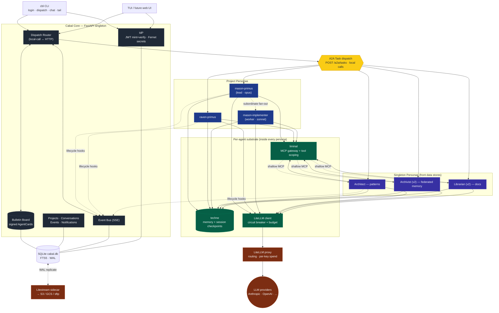

# Cabal — System Architecture

One diagram, one read. For the decisions behind it see [CABAL-DECISIONS.md](../CABAL-DECISIONS.md);
for the build log see [STATUS.md](../STATUS.md) and [CABAL-DECISIONS.md](../CABAL-DECISIONS.md).

## Layers

**Clients.** `cbl` is the operator-facing CLI; everything in the diagram is reachable
through it. Future TUI / web UIs land on the same auth + dispatch endpoints.

**Cabal Core.** One FastAPI singleton holding the dispatch router, bulletin board
(signed AgentCards keyed by name), JWT IdP (issues operator + per-persona bearer
tokens; rotates the AgentCard signing key under Fernet at rest), project/conversation/
event tables, and the SSE event bus. State lives in one SQLite file; Litestream
streams the WAL off-host for durability.

**A2A wire, pre-1.0 method names.** Between processes, cabal's own dispatch posts the
Task to `POST /a2a/tasks` on the target (`router._dispatch_remote`); it does not use a
JSON-RPC envelope. Its HTTP(S) targets carry an endpoint first registered by `cbl
persona graduate --endpoint` (primus rotation copies it forward), in practice a
sovereign peer such as daedalus, whose `/a2a/tasks` takes that bare Task. cabal's own
`/a2a/tasks` takes a `{target, task}` envelope instead, so a persona graduated to
another cabal's URL would be rejected on the body shape (#264). For other callers,
each agent serves A2A JSON-RPC on `POST /agents/{name}` with the method names of A2A
0.3.0 (`message/send` and `tasks/get`, with `message/stream` on
`/agents/{name}/stream`), where A2A v1.0 uses PascalCase (`SendMessage`, `GetTask`).
Every JSON-RPC and stream call needs a cabal-issued bearer token; the card is readable
without one. Discovery differs from both 0.3.0 and v1.0, which serve the AgentCard at
`/.well-known/agent-card.json` with signatures in a `signatures` array inside it: the
card cabal serves at `/agents/{name}/.well-known/agent-card` is the stored card,
`{"jws": ..., "card": ...}` for a persona cabal signs, and the root
`/.well-known/agent-card` is an unsigned stub (#261). Those are the legacy routes. Since
0.3.0 each persona also serves the A2A v1.0 interface at `POST /agents/{name}/a2a` and a
signed v1.0 card at `/agents/{name}/.well-known/agent-card.json`, and
`/.well-known/agent-card.json` serves the card of the `front_door` persona (#270; epic #272). The router collapses local hops
to direct Python calls when target and caller share a process. The caller's bearer JWT
is verified on every hop regardless (`router._prepare`), so the security model is
uniform across solo and per-pod deployments. The router does **not** verify AgentCards
when it dispatches: `_dispatch_remote` forwards the caller's JWT, and that JWT is the
trust. `AgentCardVerifier` (`core/a2a/card.py`) exists and is tested, but nothing on
the dispatch path calls it (#226).

**Personas.** Project personas (mason, raven, …) own the work. Primus agents own
plan/dispatch/aggregate; subordinates fan out under them. Singleton personas
(Architect; Archivist + Librarian in v2) front shared data stores and expose two
faces: A2A for synthesis dispatches and MCP for cheap shallow retrieval that
bypasses the LLM.

**Per-agent substrate.** Every persona container (and the solo-mode in-process
equivalent) ships the same three pieces: **liminal** as the MCP gateway and
tool-scoping runtime, **techne** as agent-local memory + session checkpoints,
and the **LiteLLM client** wrapper with a single-probe circuit breaker and
budget reservation. Identical inside project personas and singleton personas.

**External.** LiteLLM proxy (one per deployment) handles model routing and
per-virtual-key spend. Litestream pushes WAL frames to object storage.

## Conventions

- **Solid arrow** — request/dispatch flow (caller → callee).
- **Dotted arrow** — async, event-emitted, or out-of-band (lifecycle hooks,
  subordinate fan-out, shallow MCP retrieval, WAL replication).
- **Diamond node (A2A)** — protocol surface, not a process.
- **Hexagon nodes (techne, DB, bulletin board)** — durable stores.

## What is *not* in this diagram

- Notification adapters (Slack, iMessage, …) hang off `Notifications` table and the
  event bus; they're transport-shaped, not architectural.
- Hot-reload (`POST /admin/reload/identity`) — operational surface, not data flow.
- Streaming SSE (`message/stream`) — same broker path with token-by-token framing
  on top.
- Detailed lifecycle hook taxonomy — NOT WRITTEN DOWN. `HookName` at
  `src/cabal/core/hooks/registry.py:37` is the authority; the call sites are the taxonomy.
  (This line used to point at the original Cabal design document, which is not in
  this repo — see #202.)
